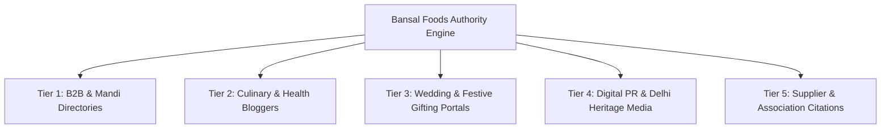

# Bansal Foods – Comprehensive Backlink Acquisition Strategy

## Executive Summary

For Bansal Foods, domain authority (DA) and organic search rankings depend heavily on relevant, high-quality, local and industry-specific backlinks. Sourced from the historic **Khari Baoli, Old Delhi** spice & dry fruits market, Bansal Foods has unique brand storytelling advantages (generations of trust, direct mandi sourcing, authentic Kashmiri Mamra almonds) that appeal to food journalists, culinary bloggers, wedding portals, and corporate buyers.

---

## 1. High-Priority Link Building Tiers



---

### Tier 1: B2B Marketplaces & High-DA Business Citations

_Objective: Build foundational domain trust, NAP (Name, Address, Phone) consistency, and wholesale lead generation._

1. **IndiaMART (`indiamart.com` - DA 84)**
   - Setup a verified Bansal Foods verified supplier profile.
   - Link directly to `https://bansalfoods.in/wholesale` and `https://bansalfoods.in/category/almonds`.
   - List key SKUs: Kashmiri Mamra Almonds, W240/W320 Cashews, Afghan Green Pistachios.

2. **TradeIndia (`tradeindia.com` - DA 76)**
   - Create detailed company catalog with Khari Baoli address and link back to `https://bansalfoods.in`.

3. **Justdial & Sulekha (`justdial.com` - DA 78, `sulekha.com` - DA 74)**
   - Claim and optimize Bansal Foods listing in "Dry Fruit Wholesalers in Khari Baoli, Delhi".
   - Include direct website button and categories.

4. **Google Business Profile (Local SEO Anchor)**
   - Primary Category: "Dry Fruit Store", "Wholesaler".
   - Link website to `https://bansalfoods.in` with UTM tracking (`?utm_source=gbp&utm_medium=organic`).
   - Post weekly updates linking to newly published blog articles and festive offers.

---

### Tier 2: Culinary, Nutrition & Food Blogger Outreach

_Objective: Secure high-relevance contextual in-content do-follow links from trusted recipe and wellness creators._

1. **Target Niches**:
   - Indian sweet recipes (Mithai chefs, Halwais, festive baking).
   - Health & fitness nutritionists (Keto, Ayurveda, heart-healthy diets).
   - Traditional immunity boosters (Kadha, panjiri, dry fruit laddoos, soaked Mamra almonds).

2. **Content Collaboration Angles**:
   - _"Why Kashmiri Mamra Almonds Have 3x More Oil Than California Almonds"_ (Sponsoring authentic samples for comparison reviews).
   - _"How to Identify Pure W320 Cashews vs Adulterated Nuts"_ (Expert interview quotes with Shashwat Bansal).
   - Resource link pitches to existing articles titled _"Best Dry Fruits for Pregnancy / Memory"_.

---

### Tier 3: Wedding Planners & Gifting Platforms

_Objective: Capture high-ticket wedding favor and festive corporate gifting links._

1. **Wedding Portals**:
   - **WedMeGood (`wedmegood.com` - DA 68)**: List under "Wedding Favors & Edible Gifting Delhi".
   - **WeddingWire India (`weddingwire.in` - DA 62)**: Showcase brass trays, brocade potlis, and royal festive boxes.
   - **ShaadiSaga / WeddingBazaar**: Pitch guest articles on _"Trending Eco-Friendly & Healthy Edible Favors for Indian Weddings"_.

2. **Corporate HR & Gifting Networks**:
   - Pitch corporate gifting agencies and HR portals on _"Premium Festive Dry Fruit Hampers Direct from Khari Baoli Mandi with Custom Company Branding"_.

---

### Tier 4: Digital PR & Delhi Heritage Storytelling

_Objective: Earn viral, high-authority news links (DA 70+)._

1. **Heritage Angle Pitch**:
   - Story: _"How a Historic Khari Baoli Dry Fruits Merchant is Modernizing Mandi Sourcing for Pan-India D2C Delivery"_.
   - Outlets: **The Better India**, **YourStory**, **LBB Delhi (Little Black Book)**, **WhatShot Delhi**, **CurlyTales**, and **Times of India Delhi Times**.

2. **Seasonal PR Angles**:
   - **Diwali & Rakhi Season (Aug - Nov)**: Mandi price trends, how unseasonal rains affect almond harvests in Kashmir.
   - **Winter Wellness (Dec - Feb)**: Top dry fruits to generate internal body warmth (Chilgoza, Mamra, Figs).

---

## 2. Outreach Email Templates

### Template A: Blogger Sample & Collaboration Pitch

```text
Subject: Authentic Kashmiri Mamra Almonds for your next recipe [Bansal Foods]

Hi [Blogger Name],

I love your recent recipe for [Recipe Name]—the presentation was exquisite!

I'm Shashwat from Bansal Foods, a multi-generational dry fruits merchant based out of historic Khari Baoli Mandi in Old Delhi.

We would love to send you a complimentary box of our single-origin Kashmiri Mamra Almonds and Afghan Green Pistachios to test out in your healthy snacking or festive dessert recipes.

If you enjoy the crunch and natural oil content, we'd be honored if you gave us a quick shoutout or linked to our Khari Baoli origin guide (https://bansalfoods.in/about).

Where should we courier your tasting box?

Warm regards,
Shashwat Bansal
Bansal Foods | Khari Baoli, Delhi
https://bansalfoods.in
```

---

### Template B: Guest Post / Expert Quote Pitch

```text
Subject: Expert Mandi quote on dry fruit adulteration & quality tests

Hi [Editor Name],

I noticed your insightful guide on [Article Title] on [Publication Name].

With the festive season approaching, many consumers are unaware of how to distinguish authentic sulfur-free raisins or cold-climate Kashmiri almonds from chemically bleached varieties.

As a direct merchant at Asia’s largest dry fruit market (Khari Baoli, Delhi), our founder Shashwat Bansal can share 4 quick kitchen tests your readers can do at home to verify dry fruit purity.

We also have a detailed nutritional breakdown available here: https://bansalfoods.in/blog/healthy-dry-fruits-daily-diet.

Would your team be open to a short quote or guest column on this topic?

Best,
The Bansal Foods Team
```

---

## 3. Anchor Text Strategy & Distribution

To maintain a natural backlink profile that avoids Google Penguin / spam penalties, strictly adhere to this anchor distribution:

| Anchor Type               | Target % | Examples                                                                             |
| ------------------------- | -------- | ------------------------------------------------------------------------------------ |
| **Branded**               | 45%      | `Bansal Foods`, `Bansal Foods Khari Baoli`, `BansalDryFruits.in`                     |
| **Naked URLs**            | 25%      | `https://bansalfoods.in`, `bansalfoods.in/shop`                                      |
| **Compound / Topical**    | 15%      | `Bansal Foods dry fruits`, `Kashmiri almonds at Bansal Foods`                        |
| **Exact & Partial Match** | 10%      | `dry fruit wholesale Delhi`, `buy Mamra almonds online`, `festive dry fruit hampers` |
| **Generic**               | 5%       | `visit website`, `read full guide`, `explore catalog`                                |

---

## 4. Quarterly Execution Roadmap

| Milestone                                 | Target Month | Activities                                                               | KPI / Deliverables                             |
| ----------------------------------------- | ------------ | ------------------------------------------------------------------------ | ---------------------------------------------- |
| **Phase 1: Local Foundation**             | Month 1      | Complete IndiaMART, TradeIndia, Justdial, GBP, and LBB Delhi listings.   | 20+ High-trust directory backlinks             |
| **Phase 2: Food Influencer Seeding**      | Month 2      | Send 30 sample boxes to Delhi-NCR food bloggers & chefs.                 | 10-15 contextual blog reviews & Instagram tags |
| **Phase 3: Wedding & Corporate Outreach** | Month 3      | Partner with WedMeGood & 10 wedding planners for edible favors.          | 5+ wedding portal links + B2B leads            |
| **Phase 4: Digital PR & News Pitches**    | Month 4      | Release festive mandi trends report to lifestyle & business journalists. | 2-4 High-DA news features                      |
